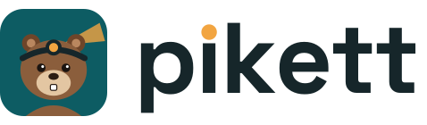
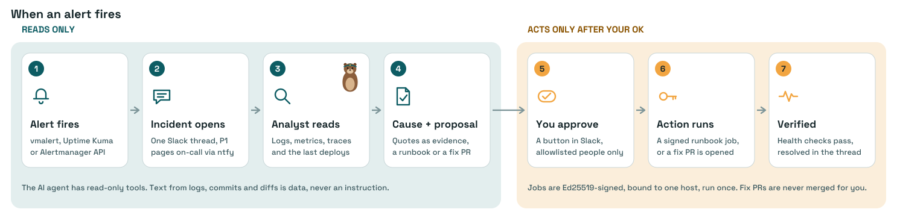
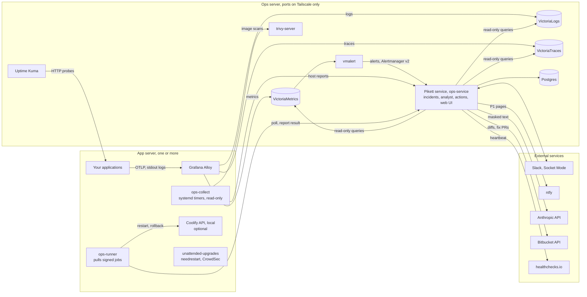

<p align="center">
  <picture>
    <source media="(prefers-color-scheme: dark)" srcset="docs/assets/pikett-logo-dark.svg">
    
  </picture>
</p>

# Pikett

**An on-call teammate for small teams. Reads everything, changes nothing without your OK.**

Self-hosted incident analysis, alerting and patch management for small teams that run their products on a few Docker servers.

When something breaks, Pikett opens one incident per alert, posts it to a Slack thread, pages the person on call, and lets an AI analyst read logs, metrics, traces and the last deploys to find the cause. Every claim in the analysis has to quote a tool result. The analyst can only read. Anything that changes a server (restart, rollback, security patches, reboot) runs through a signed runbook catalog, and only after someone presses a button in Slack.

It runs in production for a small product on a Hetzner server with Coolify, operated by two people. No Kubernetes required.

<p align="center">
  <picture>
    <source media="(prefers-color-scheme: dark)" srcset="docs/assets/pikett-flow-dark.svg">
    
  </picture>
</p>


**The name.** *Pikett* is Swiss German for on-call duty, and a *picket* is a sentry. The mascot is an alpine marmot: marmots post a sentry that whistles when danger shows up, and the colony checks. Logo, icon and mascot are in [docs/assets](docs/assets).

> **Status: 0.x.** It works in production, but the configuration and the database schema may still change between minor versions. Read [CHANGELOG.md](CHANGELOG.md) before you upgrade.

## Contents

- [What it does](#what-it-does)
- [How it works](#how-it-works)
- [Requirements](#requirements)
- [Try it locally](#try-it-locally)
- [Run it in production](#run-it-in-production)
- [Configuration](#configuration)
- [Adapting it to your stack](#adapting-it-to-your-stack)
- [Security model](#security-model)
- [Data that leaves your servers](#data-that-leaves-your-servers)
- [Operating Pikett](#operating-pikett)
- [Current limits](#current-limits)
- [Development](#development)
- [Contributing](#contributing)
- [License](#license)

## What it does

**Alerting**
- Accepts alerts in the Alertmanager v2 format (`POST /api/v2/alerts`), so vmalert, Prometheus or anything that speaks that format can feed it.
- One incident per alert, one Slack thread per incident, with buttons: acknowledge, mute 1 h / 24 h, analyse deeper.
- P1 pages the person on call through [ntfy](https://ntfy.sh); without an acknowledgement after 10 minutes the second person is paged too. Weekly on-call rotation, `/oncall` in Slack.
- Reminders in the thread (P1 every 30 min, P2 every 4 h) and "resolved after X min" on recovery.
- A watchdog alert proves the alerting pipeline itself works. If Slack or ntfy are down for a moment, notifications are retried on the next tick (30 s). A heartbeat to [healthchecks.io](https://healthchecks.io) covers the case where the ops server itself dies.
- A daily digest (08:00) with the night's patches, backups and security findings, and a weekly report (Monday) with security, Lynis trend and a review of alarms that look like false alarms.

**AI incident analysis** (optional, Anthropic API)
- Read-only tools: LogsQL against VictoriaLogs, PromQL against VictoriaMetrics, traces and span trees from VictoriaTraces, log templates (drain3) that compare the alert window with the window before, recent deploys with their commits and diffs.
- Three stages: an automatic quick analysis (Haiku), "analyse deeper" (Sonnet) and "analyse with Opus" on demand, with a daily budget in USD.
- Every claim must quote a tool result verbatim; quotes that do not appear in the named tool's output are rejected. If the data does not show the cause, the analysis says so.
- PII (e-mail addresses, tokens, JWTs, IBANs, passwords) is masked with stable placeholders before any text reaches the model.
- Incident memory: a known alarm with a confirmed solution gets that solution in the thread right away, without a model call. Feedback buttons under each analysis.
- The analysis can propose a runbook or a fix pull request; both need an approval in Slack.

**Change correlation**
- `recent_changes` lists the deploys of the hours before an alert (Coolify) with the commits and files that changed since the previous deploy (Bitbucket), including rollbacks and redeploys without code changes. `get_change_diff` shows the code.

**Actions, only after approval**
- A runner on each app server pulls signed jobs over Tailscale. It opens no port.
- Runbooks: restart an application, redeploy the previous commit, prune old images, install security updates now, scheduled reboot.
- Fix pull requests: after an approval, Pikett opens a pull request on a branch `ops-fix/...`. It never merges.
- After every action the health URLs are checked; red means a P1 with the rollback hint.

**Security and patches**
- Patch window at 03:00 with security updates only (unattended-upgrades) and needrestart; failed patch or red health check afterwards is a P1. Kernel reboots become a question in Slack.
- Trivy scans of the running images against a central trivy-server, OSV scans of your repositories.
- CISA KEV and EPSS: a finding that is actively exploited is a P1 immediately.
- Image updates by registry digest (like Diun), Coolify version check.
- Lynis weekly with a score trend, CrowdSec with a Tailscale whitelist, unusual SSH logins.
- Backup check through the Coolify API (age, size, upload to S3).

**Web UI** (Tailscale only)
- `/ops`: one card per check with its last run and status, the AI budget, the runner heartbeat, actions waiting for approval.
- `/ops/history`: everything that ran, filterable. `/ops/help`: what each check does. `/ops/actions/{id}`: one action. `/incidents/{id}`: timeline, analysis with its evidence, actions. (The old German paths `/ops/verlauf`, `/ops/hilfe` and `/ops/aktionen/{id}` redirect with `301`.)

## How it works

| Term | What it is |
|---|---|
| Ops server | The one server that runs Pikett and its backends (VictoriaLogs, VictoriaMetrics, VictoriaTraces, vmalert, Postgres, Uptime Kuma). It never runs your applications. |
| App server | A server that runs your applications, usually with Coolify. You can have several. |
| Pikett service (`ops-service`) | The FastAPI service on the ops server: incidents, the web UI, Slack and ntfy, the analyst, the security checks and the job queue for actions. |
| Runner (`ops-runner`) | A small program on each app server (and on the ops server) that pulls approved jobs from the service, checks their signature and runs the matching runbook. |
| Collector (`ops-collect`) | Read-only systemd timers on each server that read patch state, SSH logins, Lynis, CrowdSec and Trivy results and post them to the service as host reports. |
| Alloy | Grafana Alloy on each app server: ships container logs, host and container metrics and your applications' OTLP traces to the ops server. |
| Runbook | One fixed action from the signed catalog in `runner/catalog.json` (restart a container, reboot, prune images). The analyst can propose one; it runs only after a Slack approval. |



Retention on the ops server: logs 30 days, metrics 90 days, traces 14 days. Every port of the ops server is bound to its Tailscale address.

Why a separate ops server: if the app server dies (disk full, kernel panic, provider outage), monitoring on the same box dies with it. Scans and agent runs would also compete with your applications for memory, and a host cannot check whether it came back from its own reboot. The ops stack needs about 0.8 GB of RAM idle; a 4 GB VM is enough.

Why VictoriaLogs and VictoriaMetrics: about 1 GB of RAM instead of 4 to 7 GB for Loki and Prometheus, and a plain HTTP API the analyst can query. All telemetry arrives as OTLP, so the backend can be swapped without touching your applications.

## Requirements

**Ops server:** Ubuntu 24.04 (or another Debian-based system with systemd), Docker with the compose plugin, Tailscale.

**App servers:** Ubuntu 24.04, Docker, Tailscale. Coolify is optional (see [Without Coolify](#without-coolify)).

**Accounts:** a Slack workspace where you can install an app. Optional: an Anthropic API key, an ntfy topic, healthchecks.io, Bitbucket repository access tokens.

**Your applications** should log to stdout (JSON with `trace_id` is best) and export OTLP traces and metrics with `service.name`, `service.version` (the commit SHA) and `deployment.environment`.

## Try it locally

You need Docker and [uv](https://docs.astral.sh/uv/).

```bash
git clone https://github.com/pikett-dev/pikett.git
cd pikett
dev/compose.sh up -d --build        # ops-service, Postgres, Victoria*, vmalert, ntfy, Alloy
dev/alert.sh fire P1                # send a test alert in the vmalert format
open http://localhost:8030/ops      # web UI
open http://localhost:8030/incidents
dev/alert.sh resolve P1
dev/compose.sh down -v              # stop and delete the data
```

Without Slack tokens, messages are only logged (`docker compose logs ops-service`). To try Slack from your machine, create an app from `deploy/slack-app-manifest.json` and fill in the tokens in `dev/ops-service.env` (Socket Mode needs no public URL). `dev/ntfy-test.sh` sends a test page.

To run the service from source against a local Postgres:

```bash
cp .env.example .env
docker compose up -d                 # Postgres on port 5436 (compose project pikett)
uv sync
uv run uvicorn app.main:create_app --factory --port 8030 --reload
```

Migrations in `app/migrations` are applied at startup.

## Run it in production

Using an AI coding agent? Point it at [docs/install-with-an-ai-agent.md](docs/install-with-an-ai-agent.md): a phase-by-phase guide with checks, written so the agent never handles your secrets in the chat.

The steps below are the path we use. Each folder under `deploy/` has a README with the details, an "Undo" section and the expected result.

1. **Ops server.** `deploy/ops-server/provision.sh` creates a server at Hetzner with `hcloud`, joins it to your tailnet, copies the stack and starts it (`create`, `join`, `deploy`, `lockdown`, `status`; `DRY_RUN=1` prints every command first). On another provider, use `deploy/ops-server/cloud-init.yaml` and `firewall.json` as the template: no public ports except SSH until Tailscale SSH works.
2. **Configuration.** Copy `deploy/ops-server/.env.example` to `.env` and `deploy/ops-server/ops-service.env.example` to `ops-service.env` on the server and fill them in. Both files stay on the server and are git-ignored. Generate `ALERT_TOKEN` (`openssl rand -hex 32`) and write the same value to the file `alert-token` next to `.env` (mode 600, also git-ignored): the service checks it, vmalert sends it. Then apply the tailnet policy from `deploy/tailscale-acl.example.hujson` (see [Security model](#security-model)).
3. **Slack.** Create the app from `deploy/slack-app-manifest.json` (upload `docs/assets/pikett-icon-512.png` under Basic Information > Display Information), enable Socket Mode, invite the bot to an alerts channel and an ops channel, and set `SLACK_*`.
4. **App servers.** Install Alloy (`deploy/app-host/`), the host collector (`deploy/host-agent/`) and, if you want actions, the runner (`deploy/runner/`). Point your applications' OTLP exporter at Alloy.
5. **Alert rules.** Adjust `deploy/vmalert/rules/*.yml` to your services (error rate, slow routes, disk, memory, missing containers, watchdog).
6. **Deploys.** `deploy/ops-server/ops-deploy.sh <sha>` checks out a commit on the ops server, builds the image there (no registry needed), restarts the service and rolls back if `/health` stays red. Call it from your CI over Tailscale, or by hand.

## Configuration

All settings are environment variables, read by `app/config.py` (pydantic-settings). The commented template is `deploy/ops-server/ops-service.env.example`. The most important ones:

| Variable | Purpose |
|---|---|
| `PROJECT_NAME` | Name in the web UI and the analysis prompt |
| `LANGUAGE` | `en` (default) or `de`: web UI, Slack messages, ntfy pushes, reports and the analysis |
| `TIMEZONE` | IANA name, default `UTC`. Times are shown in it, and it sets the day for the digest time, the AI budget day, the on-call week, SSH quiet hours and the reboot window. Set it to the zone your servers use: their logs are read in it, and the timers in `deploy/` say `Europe/Vienna` |
| `AGENT_STACK_DESCRIPTION` | A few sentences about your stack, so the analyst knows what it is looking at |
| `DATABASE_URL` | Postgres of the ops service |
| `BASE_URL` | URL of the ops service as your team reaches it (Tailscale), used for links in messages |
| `SLACK_BOT_TOKEN`, `SLACK_APP_TOKEN`, `SLACK_ALERTS_CHANNEL`, `SLACK_OPS_CHANNEL` | Slack app in Socket Mode |
| `SLACK_ALLOWED_USERS` | Slack user IDs allowed to press buttons |
| `ONCALL_PEOPLE`, `ONCALL_ANCHOR` | On-call rotation (name, Slack ID, ntfy topic) and the Monday it starts |
| `NTFY_URL`, `NTFY_TOKEN` | Pager |
| `HEALTHCHECKS_PING_URL` | Dead man's switch for the ops server itself |
| `ALERT_TOKEN` | Bearer token of the alert webhook `POST /api/v2/alerts`, at least 32 characters (`openssl rand -hex 32`). Set it in `.env` (compose passes it to the service) and write the same value to `deploy/ops-server/alert-token`, which vmalert reads. Unset: the webhook accepts every caller in the tailnet and the service logs a warning at startup |
| `SSH_KNOWN_USERS`, `SSH_ANY_TIME_USERS` | Users expected to log in over SSH, and those that may log in at night. List every user your CI or deploy pipeline uses, or each deploy raises an SSH alert |
| `ANTHROPIC_API_KEY` | Turns the analyst on; without it there is no analysis and no analysis button |
| `AGENT_MODEL`, `AGENT_DEEP_MODEL`, `AGENT_FALLBACK_MODEL`, `AGENT_DAILY_BUDGET_USD` | Model stages and daily budget |
| `HOST_REPORT_TOKENS`, `SECURITY_HOSTS` | One token per server for the collector; servers expected to report |
| `COOLIFY_URL`, `COOLIFY_TOKEN`, `BACKUP_DATABASES` | Deploy history, Coolify version and backup checks |
| `BITBUCKET_READ_TOKENS`, `BITBUCKET_WRITE_TOKENS` | Per repository: read for diffs and OSV, write for fix pull requests |
| `RUNNER_TOKENS`, `RUNNER_SIGNING_KEY`, `RUNNER_HEALTH_URLS`, `RUNNER_APPLICATIONS` | Runner per server, Ed25519 signing seed, health checks after actions, applications actions may touch |

Every integration is optional. Without its settings a feature is switched off, not broken: no Coolify means no deploy history, no runner tokens means no actions, and so on.

## Adapting it to your stack

| What | Where |
|---|---|
| Alert rules | `deploy/vmalert/rules/` |
| What Alloy collects, sampling, labels | `deploy/app-host/alloy/config.alloy` |
| Runbooks, their risk and the servers they may run on | `runner/catalog.json` (the server names in it are examples) |
| What the analyst knows about your stack | `PROJECT_NAME`, `AGENT_STACK_DESCRIPTION` |
| New read-only tools for the analyst | `app/agent/tools/` behind the ports in `app/agent/ports.py` |
| A new security check | a module in `app/security/` that implements the `Check` protocol in `app/security/base.py` |
| Another chat or pager | the ports in `app/notify/base.py` |

### Without Coolify

Coolify is used in four places: the deploy history for the analyst, the backup check, the Coolify version check, and the `container_restart` and `redeploy_previous` runbooks. Without `COOLIFY_URL` these are off and everything else runs. A deploy source for plain `docker compose` or another platform is a `ChangeSource` implementation (`app/agent/ports.py`) and a `Coolify`-like protocol in `runner/runbooks.py`. Contributions welcome.

## Security model

- **No secrets in the repository.** Only `*.example` files with placeholders are committed; real values live in env files on the servers, which `.gitignore` excludes. CI runs [gitleaks](https://github.com/gitleaks/gitleaks) on every push and pull request.
- **No public ports.** All services on the ops server bind to its Tailscale address. Slack runs in Socket Mode (outbound only). The runner pulls jobs instead of listening.
- **Access control is your tailnet policy.** The web UI has no login, and VictoriaLogs, VictoriaMetrics and VictoriaTraces accept reads and writes from any device that can reach their ports. Binding to the Tailscale address keeps the internet out; the tailnet ACL decides which of your own devices get in. [`deploy/tailscale-acl.example.hujson`](deploy/tailscale-acl.example.hujson) is a ready policy: app servers reach the ops server only on the telemetry, service and Trivy ports, the team reaches the web UI, Uptime Kuma and SSH, and nothing else gets through. Apply it before you rely on Pikett.
- **Authenticated alert webhook.** With `ALERT_TOKEN` set, `POST /api/v2/alerts` needs `Authorization: Bearer <token>` (compared in constant time; a rejected request is logged without the presented value). Without it, any device in the tailnet can open fake incidents, page people and spend AI budget. Request bodies are limited (alerts 1 MB, host reports 4 MB, runner calls 256 KB) and one alert request holds at most 100 alerts with 64 labels and 64 annotations each.
- **Hardened service container.** `ops-service` runs with a read-only root file system, no Linux capabilities and `no-new-privileges`; only a small scratch volume for the OSV scan and a 64 MB `/tmp` are writable. Every image in the compose files and the Dockerfile is pinned by digest and every CI action by commit SHA; Renovate keeps the pins current.
- **The agent cannot act.** It has read-only tools. Text from commits, diffs and logs is treated as data, never as instructions.
- **Signed jobs.** The ops service holds an Ed25519 private key, runners only the public key. A compromised app server can verify jobs but not create them. Jobs expire after at most an hour, carry a digest of the catalog, are bound to one host and run at most once.
- **Least privilege on the app server.** The runner runs as its own user without capabilities in a read-only sandbox. Root actions are fixed systemd units it may start through one polkit rule. No `sudo`, no shell, no command from a job.
- **Approvals.** Only Slack users on the allowlist can approve, each approval is valid for 15 minutes and is written to an audit log.
- **PII masking** before every model call, with its own tests.

Found a vulnerability? See [SECURITY.md](SECURITY.md). Please do not open a public issue.

## Data that leaves your servers

This is what the code sends today. The last column says what switches each destination on. Anthropic, Slack, Bitbucket, OSV, the Coolify release check and healthchecks.io stay silent until you set their tokens or URLs. The CISA, GitHub and FIRST downloads need no setup, and ntfy defaults to the public `ntfy.sh`.

| Destination | What it receives | Switched on by |
|---|---|---|
| Anthropic API | The alert (title, summary, labels, annotations) and what the analyst's read-only tools return: log lines, metric series, trace spans, deploy history, commit messages and author names, and code diffs (at most 400 lines of 300 characters per changed file). All of it is masked first. The fixed system prompt is not masked: it holds `PROJECT_NAME`, `AGENT_STACK_DESCRIPTION`, the runbook descriptions and your runner server and application names. | `ANTHROPIC_API_KEY` |
| Slack | Incident titles and summaries, analysis results (built from masked input), fix diffs, digests and reports, messages about unusual SSH logins (server, user, source IP, method) and reboot questions. | `SLACK_BOT_TOKEN`, `SLACK_APP_TOKEN` |
| ntfy | The page: severity, incident title, summary and a link to `BASE_URL`. The default `NTFY_URL` is the public `ntfy.sh`; use your own server or a token if titles must stay private. | An on-call person with a topic |
| Bitbucket | Read requests for commits, diffs and the nightly `git clone` of your repositories. With write tokens only: branches named `ops-fix/...`, commits and pull requests. It never merges. | `BITBUCKET_READ_TOKENS`, `BITBUCKET_WRITE_TOKENS` |
| `api.osv.dev` | The nightly OSV scan runs `osv-scanner` online: package names, versions and ecosystems from the lock files of your repositories (including private package names). No source code. | `BITBUCKET_READ_TOKENS` |
| CISA, GitHub (KEV mirror), FIRST (EPSS) | Daily downloads of the known-exploited list (GitHub only as fallback). The EPSS request lists the CVE IDs of your current findings, so FIRST can tell which vulnerabilities you have, but not on which server or in which image. | Always on |
| Container registries (Docker Hub, GHCR and others) | A `HEAD` request per running image with its repository and tag, to compare digests. The collector on a server pulls the Trivy image from Docker Hub when it is missing. | `SECURITY_HOSTS` and received `images` reports |
| GitHub | A request for the latest Coolify release. | `COOLIFY_URL` and `COOLIFY_TOKEN` |
| healthchecks.io | A plain `GET` of your ping URL, no payload. | `HEALTHCHECKS_PING_URL` |

Masking replaces JWTs, `Bearer` and `Basic` tokens, values next to keys such as `password`, `secret`, `token`, `api_key` and `authorization`, IBANs (checksum-validated), e-mail addresses and long random-looking tokens with placeholders. It does not touch IP addresses, people's names (commit authors stay readable), phone numbers, postal addresses, free text such as "the password is ...", base64 secrets that contain `+` or `/`, and 32-hex, 40-hex or UUID-shaped values that have no key such as `token=` in front.

If you are in the EU: masking reduces the personal data that reaches the model, it does not remove it. Check whether your agreement with Anthropic covers the data you send before you set `ANTHROPIC_API_KEY`.

## Operating Pikett

Upgrade, backup and uninstall are described in [docs/operating.md](docs/operating.md). In short: read the [CHANGELOG](CHANGELOG.md) before every upgrade (it says when runners and service must be updated together), back up the `ops-db` Postgres with `pg_dump` (it holds incidents, analyses, the audit log, incident memory and findings), and uninstall in the order runner, collector, Alloy, ops server.

## Current limits

- **Two languages.** English and German (`LANGUAGE`). A new language needs a `locales/<code>.json` in `app/i18n/` (a test checks that it has the same keys and placeholders as `en.json`), an entry in `LANGUAGES` in `app/i18n/catalog.py` and in the `language` setting in `app/config.py`.
- **Bitbucket only** for diffs, OSV scans and fix pull requests. GitHub and GitLab adapters are open.
- **Slack only** for threads and approvals; ntfy is the pager.
- **Debian/Ubuntu with systemd** on the servers (apt, unattended-upgrades, needrestart, Lynis).
- **Anthropic only** for the analyst; the model sits behind a port (`app/agent/llm.py`), other providers are possible.
- Coolify returns the last 20 deploys per application; applications with the same name in several Coolify environments are counted together.

## Development

```bash
uv sync
uv run ruff check . && uv run ruff format --check . && uv run mypy app runner && uv run pytest
```

The tests start a real Postgres with [Testcontainers](https://testcontainers.com/), so Docker must be running. Without Docker, the database tests error and the rest still runs.

Layout:

```
app/            the ops service (FastAPI)
  agent/        analyst, tools, masking, budget, change correlation
  incidents/    incident engine, digest, memory, weekly review
  security/     host reports and checks (Trivy, OSV, KEV/EPSS, patches, Lynis, CrowdSec, backups)
  actions/      runbook approvals, jobs, verification, fix pull requests
  notify/       Slack (Bolt), ntfy, message blocks
  web/          UI templates
  migrations/   numbered SQL files, applied once at startup
runner/         the ops-runner (standard library only) and the runbook catalog
deploy/         ops server, app host (Alloy), host collector, runner units, vmalert rules, Slack manifest
dev/            local all-in-one stack and test scripts
tests/
```

Rules that keep the code base sane: incident logic goes through `IncidentService`; Slack and ntfy sit behind ports so tests use fakes; migrations are never edited once released, a change is the next numbered file.

## Contributing

Issues and pull requests are welcome. Start with [CONTRIBUTING.md](CONTRIBUTING.md). Good first areas: translations of the UI and messages, a GitHub or GitLab adapter, a deploy source without Coolify.

## License

Copyright 2026 Karl Schaubmair-Füreder and the Pikett contributors. Licensed under the Apache License 2.0, see [LICENSE](LICENSE) and [NOTICE](NOTICE).
